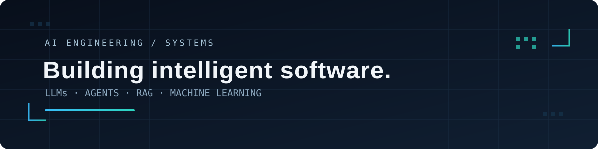

# Mohammed Talha Pirzada

### Software Engineer — AI · Agentic Systems · Applied ML

*Designing and building intelligent systems that make it from prototype to production.*

---

## Profile

I build AI-powered products and backend systems across architecture, experimentation, implementation, evaluation, and deployment. My work focuses on practical AI engineering—LLM applications, agentic workflows, retrieval systems, intelligent automation, and production-ready services.

<table>
<tr>
<td width="33%" align="center"><h3>01</h3><strong>Intelligent Systems</strong> LLMs · Agents · RAG</td>
<td width="33%" align="center"><h3>02</h3><strong>AI Engineering</strong> APIs · Evaluation · MLOps</td>
<td width="33%" align="center"><h3>03</h3><strong>Applied Research</strong> Vision · NLP · Audio</td>
</tr>
</table>

## Technology Map

<strong>AI · LLMs · Agentic Systems</strong>

 

<strong>Machine Learning · Computer Vision · Data</strong>

 

<strong>Languages · Backend · Frontend</strong>

 

<strong>Databases · Vector Search · Graph</strong>

 

<strong>Cloud · Platform · Delivery</strong>

 

<strong>Automation · Workflow · Collaboration</strong>

 

---

## Featured Projects

<table>
<tr>
<td width="50%" valign="top">
<h3>01 / Skills Intelligence & AI Hiring</h3>

AI services for competency search, vacancy and assessment generation, explainable candidate evaluation, evidence-grounded scoring, asynchronous workloads, guardrails, and continuous evaluation.

<strong>Core</strong> 

</td>
<td width="50%" valign="top">
<h3>02 / Taskflow AI Workspace</h3>

Project management and collaboration with Microsoft 365/GitHub integrations, contextual AI assistance, RAG, semantic task matching, automation, and project-health insights.

<strong>Core</strong> 

</td>
</tr>
<tr>
<td width="50%" valign="top">
<h3>03 / Multilingual Neural Audio Benchmark</h3>

Codec benchmarking for accented English and African languages across intelligibility, speaker/language preservation, perceptual quality, token efficiency, runtime, and compute cost.

<strong>Core</strong> 

</td>
<td width="50%" valign="top">
<h3>04 / Document Intelligence</h3>

Multilingual document workflows using OCR, document classification, schema-constrained extraction, and validated structured outputs. Other work includes CV, detection, voice agents, and automation.

<strong>Core</strong> 

</td>
</tr>
</table>

## Experience

**Software Engineer — AI**

Enterprise AI architecture and implementation across LLM applications, agentic workflows, retrieval systems, ML pipelines, backend APIs, and cloud deployment. Involved in solution discovery, technical design, evaluation, client collaboration, demonstrations, and production delivery.

## Current Areas of Exploration

<table>
<tr><td>01</td><td><strong>Agentic systems</strong> Reliable tool use, orchestration, and multi-step workflows</td></tr>
<tr><td>02</td><td><strong>AI evaluation</strong> Measuring quality, reliability, regressions, and model behavior</td></tr>
<tr><td>03</td><td><strong>Knowledge systems</strong> Grounded retrieval, semantic search, and structured context</td></tr>
<tr><td>04</td><td><strong>Multimodal AI</strong> Practical vision, audio, and efficient inference</td></tr>
<tr><td>05</td><td><strong>Production engineering</strong> Observability, security, and dependable deployment</td></tr>
</table>

---

### Let's build something useful.

AI engineering · thoughtful systems · continuous learning

